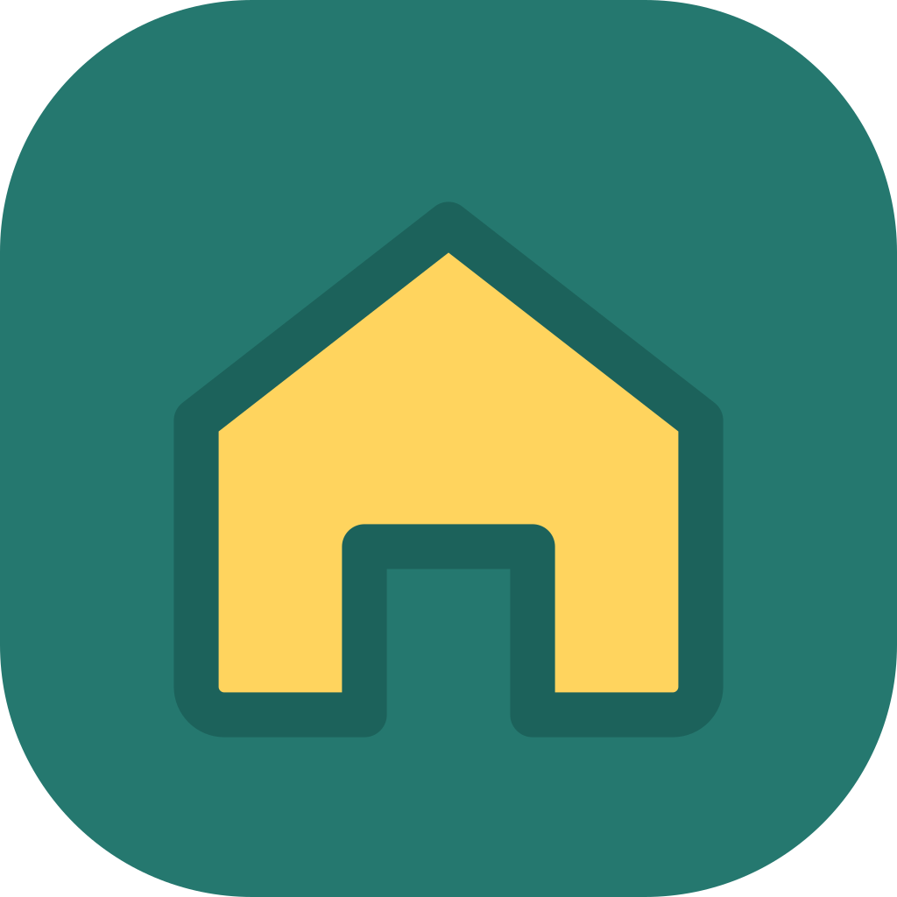
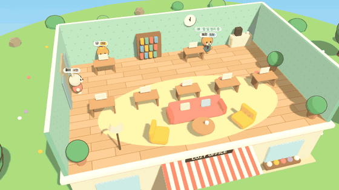

<div align="center">



# Cozy Office

**AI 직원들이 출근하는 작은 사무실**

터미널에서 혼자 돌던 Claude Code가 3D 사무실의 팀장이 돼요. 지시는 한 줄로, 결재는 대표님이.

[웹사이트](https://cozyagentoffice.com) · [다운로드](https://github.com/pj002321/agent_office_env/releases/latest) · [버그 제보](https://github.com/pj002321/agent_office_env/issues) · [English](#english)

[](https://github.com/pj002321/agent_office_env/releases/latest)
[](LICENSE)




</div>

## 주요 기능

- **프로젝트마다 한 층** — 프로젝트 폴더를 고르면 건물에 층이 하나 올라가요. 밖에서 보면 어느 층이 일하는지 창문 불빛으로 보여요.
- **한 줄 지시** — 층에 들어가 할 일을 적으면 그 폴더에서 Claude Code가 돌고, 팀장이 진행 상황을 말풍선으로 알려 줘요.
- **직원 출근** — 하위 에이전트가 생기면 직원이 엘리베이터에서 내려 자기 책상에 앉고, 지금 읽고 고치는 파일이 머리 위에 떠요.
- **대표 결재** — 파일 수정, 명령 실행, 인터넷 접근은 직원이 대표 책상까지 와서 승인을 받아요. 층마다 자동 승인으로 바꿀 수 있어요.
- **지난 대화 이어 하기** — `/resume`으로 예전 대화를, `/new`로 새 대화를 시작해요.
- **꾸미기** — 일할수록 쌓이는 포인트로 벽지, 바닥, 가구를 사고 층마다 따로 배치해요.

## 설치

| OS | 파일 | 상태 |
|---|---|---|
| Windows 10 이상 | [`AgentOffice-Setup.exe`](https://github.com/pj002321/agent_office_env/releases/latest/download/AgentOffice-Setup.exe) | 사용 가능 |
| macOS | — | 준비 중 |

아직 코드 서명을 하지 않았어요. "Windows의 PC 보호" 창이 뜨면 **추가 정보 → 실행**을 눌러 주세요.

### 필요한 것

- [Claude Code](https://github.com/anthropics/claude-code) CLI 설치, 터미널에서 한 번 로그인 (`claude auth login`)
- 사용 요금은 쓰고 계신 Claude 요금제에서 그대로 나가요.

## 개발

```bash
git clone https://github.com/pj002321/agent_office_env.git
cd agent_office_env
npm install
npm start                 # 또는 npm start -- <프로젝트 폴더>
npm test                  # 단위 테스트
npm run dist              # 설치 파일 빌드 → dist/
```

Node.js 22 이상을 권장해요. 구조는 [docs/ARCHITECTURE.md](docs/ARCHITECTURE.md)에 정리돼 있어요.

```
app/    Electron 메인 프로세스 (CLI 실행, 승인 훅, 상점·출석 상태)
web/    렌더러 (Three.js 건물, UI)
site/   홍보 사이트 (cozyagentoffice.com)
test/   node --test 단위 테스트
```

## 보안과 개인정보

- 이 앱은 **사용자가 설치하고 로그인한 CLI를 그대로 실행**해요. 토큰이나 비밀번호를 읽거나 저장하지 않아요.
- 일지를 다시 보여 주려고 `~/.claude/projects` 안의 대화 기록을 읽지만, 밖으로 보내지 않아요.
- 보안 문제는 공개 이슈 대신 아래 메일로 알려 주세요.

## 기여

버그 제보와 기능 제안은 [Issues](https://github.com/pj002321/agent_office_env/issues)에 남겨 주세요. PR을 보내기 전에 `npm test`가 통과하는지 확인해 주세요.

## 문의

- 이메일: [t55300354@gmail.com](mailto:t55300354@gmail.com)
- 웹사이트: [cozyagentoffice.com](https://cozyagentoffice.com)

## 라이선스

[MIT](LICENSE) © 2026 JaeseongHeo

Claude와 Claude Code는 Anthropic의 상표예요. Cozy Office는 Anthropic의 공식 제품이 아니에요.

---

## English

**Cozy Office** turns your local Claude Code CLI into a cozy 3D office. Each project folder becomes a floor; type a one-line order and the team lead starts working, sub-agents show up as staff at their desks, and any file edit, command, or network access waits for your approval.

- **Download:** [Windows installer](https://github.com/pj002321/agent_office_env/releases/latest) (macOS coming soon)
- **Requires:** [Claude Code](https://github.com/anthropics/claude-code) installed and logged in. The app runs your own CLI and never reads or stores credentials.
- **Develop:** `npm install && npm start`, tests with `npm test`, installer with `npm run dist`.
- **Contact:** [t55300354@gmail.com](mailto:t55300354@gmail.com) · **License:** MIT

The UI is currently Korean only.
